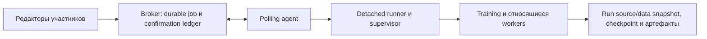

# Pair Notebook 0.5.39: совместная работа и длительное обучение

Дата проверки: 11 октября 2026 года, Europe/Moscow. Реализованы исправления
worker, durable cancellation, интерактивного владения выполнением, чекпоинтов
и наблюдателя длительного теста. Проверены настоящие Linux CPU процессы,
filesystem, Jupyter, локальный broker/agent и Torch reference pipeline.
Финальный общий прогон подтвердил 4 763 TypeScript-теста и 140 Python-тестов
без ошибок и пропусков. Проверенный код предназначен для той же исходной
ветки; SHA коммита и сверка удалённой вершины публикуются отдельно в
сопутствующем `push-receipt.json` и итоговом сообщении.

Это новый аудит изменённой 0.5.39. Исторические результаты 0.5.38 не
переносятся на новую реализацию. Машинный результат и SHA-256 конкретных
проверенных файлов: [JSON](HOST_TRAINING_AUDIT_0.5.39_2026-10-11.json).

## Основание и сохранность рабочей версии

Исходная локальная копия была чистой, `56cfd15`, версия 0.5.38. Она
сохранена. Проверка фактической удалённой вершины целевой ветки
`codex/vps-persistent-compute` получила
`7e75dec3702b72f619ea9032fca310db9e53a393`, также 0.5.38; работа продолжена
на этой актуальной основе в той же ветке. Перехода на `main`, reset,
force push, отдельного Release или изменения производственного
развёртывания не выполнялось. Пользователь выбрал проверку локального
broker/agent; внешний VPS исключён из текущего объёма инфраструктуры.

Прочитан применимый `AGENTS.md`. Octocode wrapper действительно завершился
ошибкой `ENOENT` для отсутствующего Octocode; дальнейшее исследование было
ограничено названными исходниками, зависимостями и воспроизведениями.

## Архитектура и проверенные свойства

Для обучения, которое должно переживать редактор, используется отдельный
compute agent. Broker хранит принятые задания и действия управления на
диске; polling agent доставляет задания и наблюдение. Отдельные runner и
supervisor владеют одним выполнением, его process tree, locks, выводом и
итоговым результатом. Запуск фиксируется до spawn. Неопределённый результат
доставки или crash не вызывает скрытый повтор с новым job ID.



Принятое вычисление не имеет произвольного общего wall-clock timeout.
Сохранены ограничения сетевой доставки, startup, размера/retention данных,
числа заданий и времени эскалации уже разрешённой остановки. Редкий stdout
сам по себе не отменяет обучение. Временная недоступность broker или
наблюдателя сохраняет выполнение и позволяет доставить retained result.

Source/config фиксируются для run; явно объявленные owner data копируются
потоково с проверкой идентичности и resumable partial staging. Source
snapshot сам по себе не переносит произвольный бинарный датасет.
Окружение зависимостей Python остаётся выбранным владельцем: автоматическое
клонирование venv/image и неизменяемость внешних пакетов не реализованы.
Для воспроизводимого длительного эксперимента владелец должен зафиксировать
окружение/image и версию данных.

Обычное интерактивное ядро и shared shell принадлежат Extension Host.
Закрытие/kill настоящего редактора или reload не получили гарантию
сохранения этих процессов. Durable background job является отдельным
режимом; этот предел не скрывается за успешными тестами подменённого API
VS Code. Shared terminal принимает ввод только от текущего хоста;
участники видят вывод, guest shell-input RPC отвергается.

## Воспроизведённые дефекты, исправления и доказательства

| Причина и результат до исправления | Исправление | Проверка |
| --- | --- | --- |
| Worker bootstrap исполнял изменяемый `sitecustomize`; чужой `PYTHONHOME` мог убить runner без результата. | Внутренние helpers запускаются с `-I -S`; bootstrap overrides очищены, training использует retained source. | Реальные Python subprocess, marker и итоговый receipt; worker suite. |
| Data partial/completed hardlink изменял частный inode владельца; FIFO мог блокировать staging. | Проверка regular single-link файла до открытия и через открытый fd; POSIX no-follow/nonblock. | Настоящие hardlinks/FIFO и неизменность private file. |
| Retained receipt принимал изменённый или удалённый owner/project/session перед cancel. | Immutable scope/owner проверяются до cancel marker. Только отсутствующие compact payload `files`/`args` допускаются. | Worker regressions и настоящий HTTP compact poll/output/cancellation. |
| Сбой первой записи cancellation intent или части session targets позволял несогласованное применение/claim. | Authorized `applying` intent сохраняется перед каждым recovery; incomplete операции согласуются до обслуживания работы. | Три воспроизведённых write-boundary failures; queued targets не запускаются при незавершённом stop. |
| При сбое final receipt HTTP success мог опережать диск; подмена scope/action/target/generation ledger принималась при startup. | In-memory `applying` восстанавливается при failed publication; receipt и target metadata проверяются при restoration. | Real loopback broker с fault injection и altered ledger. |
| Старый CONFIRM применялся к новому owner с тем же run ID. | Challenge связывается со случайным поколением конкретного execution owner; elapsed фиксируется при admission. | Реальный SessionRuntime, replacement owner и отказ stale consent. |
| После `KernelDied` следующая ячейка повторно использовала bridge; redirected worker оставался жив. | Bridge снимается до failed completion; Linux cleanup закрепляет PID/starttime участников принадлежащей группы и ограниченно эскалирует. | Настоящий Jupyter crash, TERM-ignoring child, исправный replacement и живой посторонний процесс. |
| Два процесса одновременно resume одного эксперимента публиковали два продолжения/checkpoint. | Kernel-owned writer lock на directory train/resume; exit освобождает владение. | Два настоящих процесса до исправления; после исправления competitor отвергнут, crash owner освобождает lock. |
| Resume/fallback мог принять checkpoint другого run; export проверял dataset bytes без полной версии manifest. | Проверка experiment provenance/run identity, epoch/step envelope, export threshold fields и полного dataset manifest. | Torch state/results equality, corruption, изменённый manifest и чужой run. |
| Наблюдатель soak исполнял mutable source; lock contender портил snapshot; crash создавал новые службы. | Frozen observer/dependencies, fsynced event ledger, Linux pidfd ownership/adoption и самостоятельный detached `observe`. | До/после регрессии и отдельный live observer SIGKILL pilot. |

Подробные воспроизведения и границы: [worker](WORKER_AUDIT_0.5.39_2026-10-11.md),
[broker](BROKER_AUDIT_0.5.39_2026-10-11.md),
[интерактивное выполнение](INTERACTIVE_AUDIT_0.5.39_2026-10-11.md),
[soak validation](validation-plan-2026-10-11.md).

## CONFIRM, полномочия и достоверная остановка

Managed UI/API требует свежий ввод точной строки `CONFIRM`: пустой ввод,
иной регистр, пробелы/добавленные символы и отмена диалога не останавливают
работу. Открытие диалога не отправляет interrupt. Challenge фиксирует
identity, action, scope, точные targets и поколения; применение одноразовое
с expiry и проверкой полномочий. Согласие старого owner не наследуется
заменой. Для общей остановки authority принадлежит текущему хосту/оператору;
scope ограничивает вычисления своего проекта/сессии.

После применения остановка включает queued/preparing работу и связанные
training descendants, сначала graceful, затем ограниченную эскалацию.
Посторонние процессы и другие scope не затрагиваются. Offline agent
получает сохранённое намерение; broker показывает `cancel_pending` до
подтверждения реальной остановки, а не обещает мгновенное выключение.
Естественное завершение остаётся достоверным success при гонке с cancel.
Receipt описывает применение операции; текущее состояние job остаётся
источником истины о последующем результате.

CONFIRM защищает поддерживаемые managed интерфейсы. Сервер проверяет
scoped authenticated consent, но не может доказать ручной ввод в
произвольном модифицированном клиенте. Доверенные shell-команды, Python-код
и действия владельца ОС могут завершать процессы и находятся вне гарантии.

## Проверки без повторного подсчёта

| Финальная Python-проверка | Уникальные тесты | Результат |
| --- | ---: | --- |
| Compute worker | 107 | passed, 0 skipped |
| Jupyter bridge | 9 | passed, 0 skipped |
| Torch reference pipeline | 16 | passed, 0 skipped |
| Real broker/reference integration | 2 | passed, 0 skipped |
| Detached soak observer | 6 | passed, 0 skipped |
| **Всего Python** | **140** | **passed, 0 skipped** |

Изолированные TypeScript проверки: interactive 42 passed и broker 46
уникальных проверок passed. Это подмножества общего набора: они не
прибавляются повторно к полному TypeScript-прогону. Его окончательная
сводка: **4763 passed, 0 failed, 0 skipped**, 382.444 секунды
на финальном compiled code. Промежуточные 4 759 тестов и целевые повторные
прогоны не увеличивают этот счётчик. Компиляция, syntax checks и ESLint
прошли; `npm audit --omit=dev` сообщает 0 production vulnerabilities.
Журналы сохранены в `/workspace/pair-validation-2026-10-11/`.

Настоящий VS Code e2e запуск завершился инфраструктурной ошибкой
`Could not find VS Code`. Подмена VS Code API в regression suites явно
отделена от реального редактора. GPU inventory может подменяться в
изолированных тестах; `torch.cuda.is_available()` в доступном CPU
окружении — false. Windows/macOS execution не проверялись.

## Reference pipeline и артефакты

На CPU реально выполнены 9 synthetic экспериментов: logistic baseline,
MLP с history и MLP без history, каждый с seeds 7, 13, 29. Данные:
`synthetic-v1-seed91-rows4000-delay24`. Хронологическое разделение с gap,
train-only preprocessing и признаки с доступностью на момент транзакции
проверяются reference suite. Отдельная интеграция исполняет путь owner
data → isolated snapshot → preprocessing/train → checkpoint → model,
optimizer/scheduler/scaler/RNG → evaluation/export → retained result,
перезапускает broker/poller и проверяет один запуск.

Resume выполняется на границах завершённых эпох, проверяет dataset/config,
environment и experiment identity; damaged checkpoint требует явного
fallback. Продолжение получает явный receipt. Partial epoch после machine
failure может пересчитываться от предыдущего committed checkpoint;
это не скрытый повтор исходного broker job. Resume pickle артефакты
допускаются только от доверенного владельца; SHA-256 проверяет целостность,
а не аутентичность.

Архив `/workspace/pair-validation-2026-10-11/synthetic-reference-0.5.39.zip`
содержит исходники, конфигурации, provenance, checkpoints, реальные
synthetic metrics и отчёт. SHA-256:
`20c76885ddcf39e3fdb9a711a744fc1bea28249d351786819ae8889c850c54ff`.
Этот результат проверяет исследовательский pipeline и инфраструктуру.
Реальные fraud data не предоставлены; научное превосходство модели,
качество на рабочих транзакциях и uncertainty для реального fraud
датасета не заявляются.

## Длительный запуск, наблюдение и восстановление

Короткий pilot после исправления worker завершил 100 шагов за
**14.27894 секунды**, один запуск. Training пережил SIGKILL живого
наблюдателя; новый observer усыновил те же broker/poller. Все 8 evidence
checks прошли. Timings faults ускорены, многочасовая продолжительность
из этого результата не выводится. Первый pilot с ошибкой compact poll
сохранён отдельно как failure evidence, а не включён в число успешных.

Отдельный default soak `soak-70596cccb0ea953b` запущен detached в
21:18:51 Moscow time: 14,400 явно заданных шагов, minimum cadence 1 секунда,
20 updates/step, checkpoint каждые 60 шагов и stdout каждые 300 шагов.
Последняя прочитанная observation: **running, 854.290 секунды, шаг
841/14,400, checkpoint 840, один training launch**. Нормальные события
broker offline/online, polling-agent restart и observation reconnect
прошли. Прогресс продолжился через отдельные команды после завершения
launching tool; чат не поддерживает живучесть процесса.

Рабочая директория:
`/workspace/pair-validation-2026-10-11/soak-long`. На этой машине:

```bash
python3 scripts/persistent-soak.py status --state /workspace/pair-validation-2026-10-11/soak-long
python3 scripts/persistent-soak.py observe --state /workspace/pair-validation-2026-10-11/soak-long
python3 scripts/persistent-soak.py cancel --state /workspace/pair-validation-2026-10-11/soak-long
```

Для самостоятельной повторной проверки используйте `start --state NEW_PATH`;
использованная директория не переиспользуется для нового job. Внутри run
хранится frozen `implementation/persistent-soak.py`, позволяющий выполнять
эти команды независимо от позднейших правок checkout. `observe` восстанавливает
наблюдение, не resume обучения. `cancel` показывает scope/run/executor,
elapsed, checkpoint и process scope и требует отдельный typed `CONFIRM`.
Источник source/data, checkpoints, RSS observations, events и hash manifest
сохраняются рядом; credentials исключаются из публикуемых отчётов.

**Четырёхчасовой soak пока не завершён.** Только terminal `succeeded` вместе
с passed `verification.json` подтвердит его завершение. Фактическое время
публикуется отдельно; ускоренный pilot или план 14,400 секунд не выдаются
за прошедшие часы. Сохранность compute требует живой машины и retained
workspace; provider shutdown, OOM, заполнение/потеря диска и hardware failure
не преодолеваются обещанием абсолютной надёжности.

## Оставшиеся границы и публикация

Непроверены настоящий VS Code UI lifecycle, Windows/macOS supervision,
физический GPU и завершённый многочасовой workload. Внешний VPS находится
вне выбранного пользователем объёма. Linux cleanup failed interactive
kernel не доказывает cleanup кода, намеренно покинувшего process group.
Долговечность broker предполагает working filesystem и single writer;
persistent storage failure делает операции unavailable до восстановления.
Writer locks reference требуют поддержки filesystem.

Установочная сборка: `pair-notebook-0.5.39.vsix`; полный source/archive:
`pair-notebook-complete-0.5.39.zip`. Состав, SHA-256 и CRC проверки находятся
в сопутствующем `build-artifacts.json`; подтверждённые local/remote SHA —
в `push-receipt.json` и итоговом сообщении. Эти квитанции сохраняются вне
самого хешируемого архива и коммита, чтобы избежать самоссылки. Код
однозначно идентифицирован SHA-256 исходников и compiled modules в JSON.
Release, tag и production deployment этой работой не создавались.
